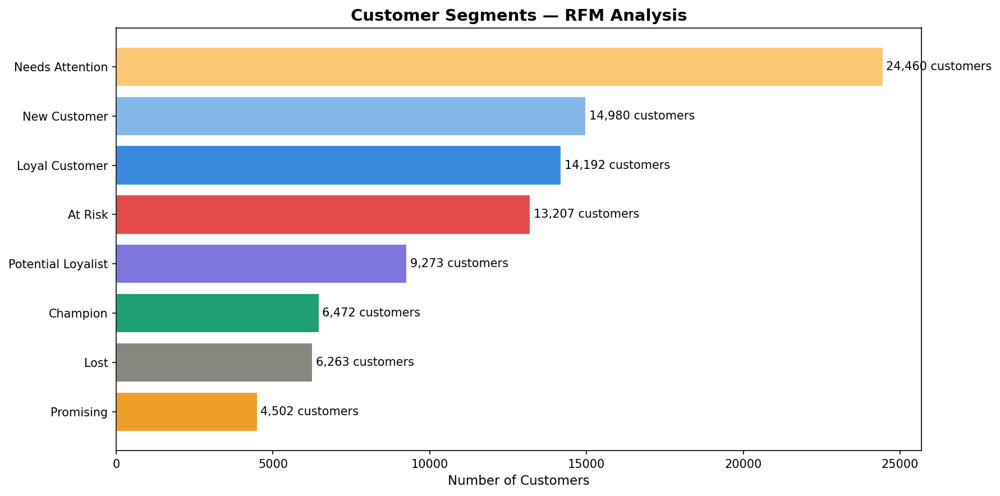
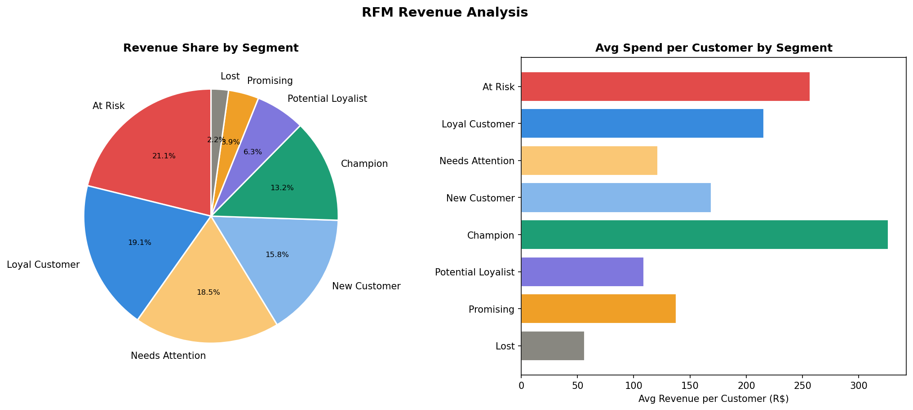
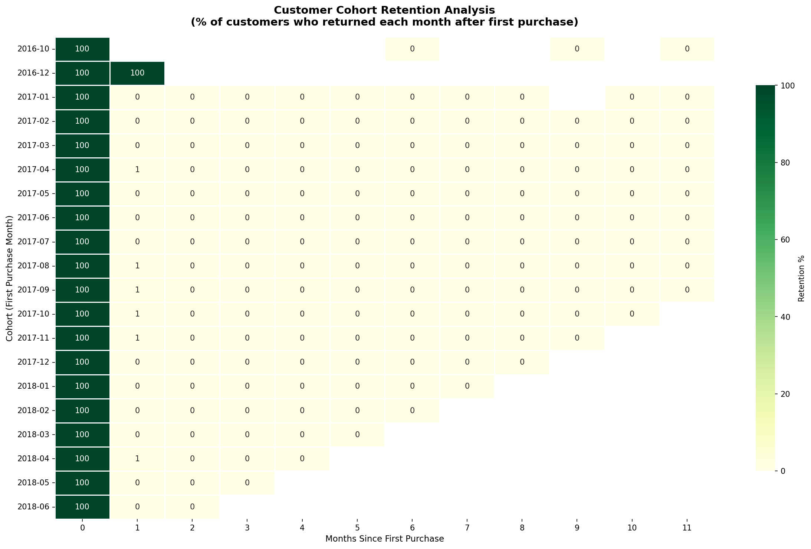
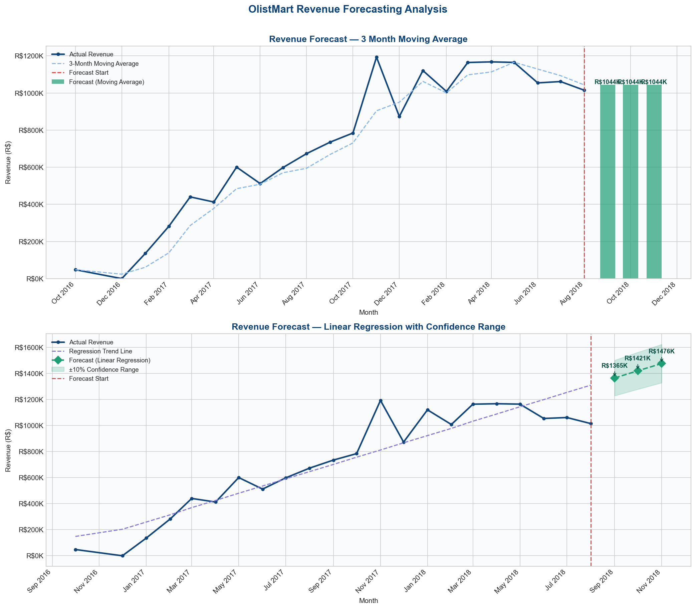

# 🛒 E-Commerce Sales & Customer Analytics

An end-to-end data analytics and business intelligence project exploring customer purchasing behavior, sales performance, cohort retention, and revenue forecasting using the Brazilian E-Commerce public dataset by Olist.

---

## 📌 Project Overview

This project provides an end-to-end analytical investigation of over 100,000 real-world e-commerce orders across 27 Brazilian states from 2016 to 2018. It combines Python for exploratory data analysis and predictive modeling, MySQL for structured business reporting, and Power BI for executive dashboarding.

The primary objective is to transform multi-table transactional records into actionable commercial insights addressing customer retention, regional logistics efficiency, revenue drivers, and future sales growth.

---

## 🎯 Business Problem

E-commerce marketplaces face intense competition and customer acquisition costs. Key strategic challenges addressed in this project include:

1. **Revenue Volatility & Seasonality**: Understanding underlying growth trends, seasonal peaks (such as Black Friday), and product category performance.
2. **Customer Retention Deficit**: Identifying churn patterns, measuring repeat purchase rates, and determining whether customers return after their initial order.
3. **Customer Value Distribution**: Segmenting customer populations using Recency, Frequency, and Monetary (RFM) metrics to protect high-value revenue and re-engage at-risk buyers.
4. **Fulfillment Bottlenecks**: Pinpointing geographic variations in shipping lead times, late deliveries, and their direct impact on customer review scores.

---

## 🚀 Objectives and Key Features

- **Data Wrangling & Pipeline Integration**: Merging 9 relational dataset tables into clean analytical extracts (`master_clean.csv`).
- **RFM Customer Segmentation**: Segmenting customers into behavioral categories (Champions, Loyal, At-Risk, Lost, One-time buyers) to guide targeted marketing.
- **Cohort Retention Analysis**: Constructing monthly cohort retention heatmaps to assess long-term customer engagement and repeat purchase rates.
- **Predictive Sales Forecasting**: Building univariate Linear Regression and Moving Average models to forecast future revenue trajectories.
- **Enterprise SQL Querying**: Developing 15+ production-style SQL queries evaluating KPIs, delivery metrics, regional revenues, and seller performance.
- **Interactive Power BI Dashboard**: Presenting multi-page visual reports covering executive KPIs, regional distribution, cohort retention, and sales forecasting.

---

## 🛠️ Tech Stack

| Category | Tools / Libraries | Usage |
|:---|:---|:---|
| **Programming** | Python 3.x | Data extraction, cleaning, modeling, and automated visualization |
| **Data Manipulation** | Pandas, NumPy, OpenPyXL | Relational joins, date conversions, RFM scoring, aggregation |
| **Data Visualization** | Matplotlib, Seaborn | Distribution plots, cohort heatmaps, regression charts |
| **Machine Learning** | Scikit-learn (`LinearRegression`) | Time-trend modeling and quarterly revenue projection |
| **Relational Database** | MySQL Workbench | Relational database schema, window functions, and business queries |
| **Business Intelligence** | Microsoft Power BI (DAX) | Data modeling, interactive KPI cards, drill-through reports |

---

## 📂 Dataset Source — Brazilian E-Commerce Public Dataset by Olist

The project utilizes the public Brazilian E-Commerce dataset released by **Olist** on [Kaggle](https://www.kaggle.com/datasets/olistbr/brazilian-ecommerce). It contains anonymized transactional records from 2016 to 2018 across multiple operational dimensions.

The raw dataset comprises 9 CSV files:
1. `olist_orders_dataset.csv`
2. `olist_customers_dataset.csv`
3. `olist_order_items_dataset.csv`
4. `olist_products_dataset.csv`
5. `olist_sellers_dataset.csv`
6. `olist_order_payments_dataset.csv`
7. `olist_order_reviews_dataset.csv`
8. `olist_geolocation_dataset.csv`
9. `product_category_name_translation.csv`

> **Note**: In accordance with best repository practices, raw dataset CSV files are excluded via `.gitignore` due to file size. Users can download them directly from Kaggle using the link above.

---

## 📁 Project Structure

```text
├── E-Commerce Sales.pbix          # Interactive Power BI Dashboard (4-page report)
├── OM_exploration.ipynb.ipynb     # Notebook 1: EDA, multi-table merge & data cleaning
├── OM_rfm_cohort.ipynb.ipynb      # Notebook 2: RFM segmentation & cohort retention analysis
├── OM_forecasting.ipynb           # Notebook 3: Time series aggregation & revenue forecasting
├── business_queries.sql           # MySQL script containing 15+ business analysis queries
├── cohort_retention_heatmap.png   # Analysis visual: Monthly cohort retention heatmap
├── revenue_forecast.png           # Analysis visual: Linear regression & moving average forecast
├── rfm_revenue.png                # Analysis visual: Revenue distribution across RFM segments
├── rfm_segments.png               # Analysis visual: Customer distribution across RFM segments
├── requirements.txt               # Python package dependencies
├── .gitignore                     # Git ignore rules for datasets, caches, and environments
└── README.md                      # Comprehensive project documentation
```

---

## ⚙️ Installation and Setup

### 1. Clone the Repository
```bash
git clone https://github.com/Aayush5154/Data-Analysis.git
cd Data-Analysis
```

### 2. Set Up a Python Virtual Environment
```bash
# Windows
python -m venv venv
.\venv\Scripts\activate

# macOS / Linux
python3 -m venv venv
source venv/bin/activate
```

### 3. Install Dependencies
```bash
pip install -r requirements.txt
```

### 4. Prepare the Dataset
1. Download the archive from [Kaggle — Olist Brazilian E-Commerce](https://www.kaggle.com/datasets/olistbr/brazilian-ecommerce).
2. Create a local folder (e.g. `data/`) and extract the 9 CSV files into it.
3. Update the `DATA_PATH` variable in the notebooks to point to your local data folder.

---

## 📓 Python Notebook Execution Order

Execute the Jupyter notebooks in the following sequential order:

### Step 1: Data Exploration & Cleaning (`OM_exploration.ipynb.ipynb`)
- Reads the 9 raw Olist CSV tables.
- Validates data types, inspects null counts, and removes cancelled or unavailable orders.
- Calculates core metrics: `revenue`, `delivery_days`, `is_late`, `order_yearmonth`.
- Joins product category English translations.
- Outputs `master_clean.csv` and `dataset_summary.xlsx`.

### Step 2: RFM Segmentation & Cohort Retention (`OM_rfm_cohort.ipynb.ipynb`)
- Loads `master_clean.csv`.
- Computes **Recency** (days since last purchase), **Frequency** (distinct order count), and **Monetary** (total spend) per unique customer.
- Assigns RFM quintile scores (1 to 5) and creates segment classifications (Champions, Loyal, At Risk, Lost, etc.).
- Builds a monthly cohort matrix tracking retention over customer lifespans.
- Exports `rfm_segments.csv`, `segment_summary.xlsx`, `rfm_segments.png`, `rfm_revenue.png`, and `cohort_retention_heatmap.png`.

### Step 3: Revenue Forecasting (`OM_forecasting.ipynb`)
- Aggregates monthly revenue from `master_clean.csv`.
- Fits an ordinary least squares Linear Regression model alongside a rolling 3-month moving average baseline.
- Projects revenue for the upcoming quarter.
- Exports `revenue_forecast.csv` and `revenue_forecast.png`.

---

## 🗄️ MySQL Database Setup and SQL Analysis

The `business_queries.sql` script at the repository root contains structured business intelligence queries.

### Setup Instructions
1. Open **MySQL Workbench** or your preferred SQL client.
2. Create and select the database:
   ```sql
   CREATE DATABASE olist_db;
   USE olist_db;
   ```
3. Import `master_clean.csv` into a table named `ecommerce` using MySQL Table Data Import Wizard or `LOAD DATA INFILE`:
   ```sql
   LOAD DATA LOCAL INFILE 'path/to/master_clean.csv'
   INTO TABLE ecommerce
   FIELDS TERMINATED BY ','
   ENCLOSED BY '"'
   LINES TERMINATED BY '\n'
   IGNORE 1 ROWS;
   ```
4. Execute `business_queries.sql` to generate insights across:
   - High-level executive KPIs (Total orders, customers, revenue, average order value).
   - Monthly and day-of-week sales volume trends.
   - Top 15 product categories by revenue.
   - Revenue and order concentration by customer state.
   - Delivery performance and late delivery percentages across regions.
   - Customer review scores by category and relationship with freight times.
   - Repeat purchase distribution (1 order vs. 2+ orders).
   - Top-performing sellers and regional logistics metrics.
   - First-time vs. returning customer monthly breakdowns using window functions.

---

## 📊 Power BI Dashboard Instructions

The Power BI dashboard file (`E-Commerce Sales.pbix`) provides an interactive view of the business:

1. Install and open **Power BI Desktop**.
2. Open `E-Commerce Sales.pbix`.
3. If prompted to update data source paths:
   - Navigate to **Home** > **Transform Data** > **Data Source Settings**.
   - Change the file path to point to your local `master_clean.csv` or MySQL database connection.
   - Click **Close & Apply**.
4. The dashboard is organized into four interactive report pages:
   - **Executive Overview**: Total revenue, order volume, average order value, and top product categories.
   - **Customer & RFM Analysis**: Segment distribution, champion identification, and spend tiers.
   - **Operations & Fulfillment**: Delivery lead times, regional late shipping rates, and review score impact.
   - **Revenue Forecasting**: Historical time trends and projected revenue figures.

---

## 📈 Key Metrics and Insights

The following insights are verified directly from the project's analytical notebooks and data extracts:

### 1. Revenue & Sales Performance
- **Total Revenue**: Over **R$ 16.04M** gross revenue analyzed across 22 historical months.
- **Average Monthly Revenue**: Approximately **R$ 729,289** per month.
- **Seasonality & Peaks**: November 2017 recorded the highest monthly revenue (**R$ 1,193,021.11**), driven primarily by Black Friday demand.
- **Geographic Concentration**: Southeastern states (**SP, RJ, MG**) account for over **57%** of total transaction volume.

### 2. Customer Retention Crisis
- **One-Time Buyers**: **90,548 customers (97.0%)** purchased only once, indicating a high reliance on continuous customer acquisition.
- **Cohort Retention**:
  - Month 1 retention drops sharply to **~5.4%**.
  - Month 3 retention falls to **~0.2%**.
  - Recommendation: Implement automated 30-day and 60-day post-purchase re-engagement email workflows to nurture repeat orders.

### 3. RFM Customer Segmentation
- **Champions (6,472 customers)**: Account for **13.2%** of revenue with an average spend of **R$ 326.00**.
- **At-Risk Customers (13,207 customers)**: Hold **R$ 3,392,816.72** in historical spend with an average recency of 394 days since their last transaction.
- **Lost Segment (6,263 customers)**: Average recency of 397 days.

| RFM Segment | Customer Count | Avg Recency (Days) | Avg Orders | Avg Monetary (R$) |
|:---|:---:|:---:|:---:|:---:|
| **Champions** | 6,472 | 102 | 1.2 | R$ 326.00 |
| **At Risk** | 13,207 | 394 | 1.1 | R$ 256.89 |
| **Lost** | 6,263 | 397 | 1.0 | R$ 81.14 |

### 4. Logistics & Operations
- **Average Delivery Time**: **12.5 days** nationally.
- **Late Delivery Regional Disparities**: Northern states (e.g., RR, AP, AM) experience significantly higher late delivery rates (**25% to 32%**), reflecting supply chain bottlenecks away from southern hubs.
- **Review Score Impact**: Analysis confirms an inverse relationship between delivery duration and review scores, where prolonged shipping times consistently drive 1-star and 2-star feedback.

### 5. Revenue Forecasting
- **Linear Regression Model Fit**: $R^2 = \mathbf{0.859}$, demonstrating that ~86% of revenue variance across the historical series is explained by the secular upward trend.
- **Trend Rate**: Trend coefficient of **R$ 55,308 per month**.
- **Quarterly Projections**:
  - Month 1 (Sep 2018): **R$ 1,365,335**
  - Month 2 (Oct 2018): **R$ 1,420,643**
  - Month 3 (Nov 2018): **R$ 1,475,952**

---

## 🔍 Visualizations

| RFM Customer Segments | RFM Revenue Contribution |
|:---:|:---:|
|  |  |

| Cohort Retention Heatmap | Revenue Forecast Model |
|:---:|:---:|
|  |  |

---

## ⚠️ Limitations and Future Improvements

- **Dataset Recency**: Data spans transactions through 2018; modern macro trends and post-2020 e-commerce shifts are not captured.
- **Forecasting Granularity**: The forecasting model utilizes univariate Linear Regression and Moving Averages on monthly totals. Future iterations can incorporate multi-variable time series frameworks (e.g., ARIMA/SARIMAX or Prophet) factoring in promotional calendars and holiday seasonality.
- **Customer Identity Anonymization**: `customer_unique_id` maps individual purchasers, but external demographic variables (age, household income) were not included in the source dataset.
- **Database Indexing**: For high-volume production deployments, MySQL indexing on `order_id`, `customer_unique_id`, and `order_purchase_timestamp` is recommended to maintain sub-second query response times.

---
---

## 🙏 Acknowledgments

- **Olist** for publishing the real-world Brazilian e-commerce dataset on Kaggle.
- **Karthik M** for the initial project implementation and analytical structure ([Source Repository](https://github.com/karthik-data-analyst/ecommerce-sales-analytics)).
